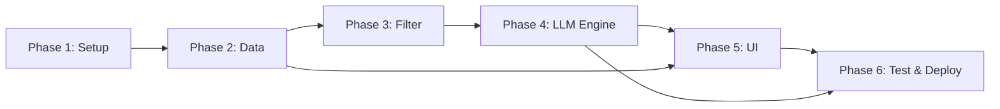

# Phase-Wise Implementation Plan

**AI-Powered Restaurant Recommendation System (Zomato Use Case)**

> **References:**
> - [context.md](file:///c:/Projects/Zomato%20bot/Docs/context.md) — Problem statement & objectives
> - [architecture.md](file:///c:/Projects/Zomato%20bot/Docs/architecture.md) — System architecture & design

---

## Overview

This plan breaks the project into **6 phases**, progressing from project setup through to deployment. Each phase is self-contained with clear deliverables, estimated timelines, files to create/modify, and acceptance criteria.

```
Phase 1          Phase 2          Phase 3          Phase 4          Phase 5          Phase 6
┌──────────┐    ┌──────────┐    ┌──────────┐    ┌──────────┐    ┌──────────┐    ┌──────────┐
│ Project  │───▶│ Data     │───▶│ Filter & │───▶│ LLM      │───▶│ UI &     │───▶│ Testing, │
│ Setup &  │    │ Ingestion│    │ Integra- │    │ Recommen-│    │ Presenta-│    │ Polish & │
│ Scaffold │    │ & Prep   │    │ tion     │    │ dation   │    │ tion     │    │ Deploy   │
└──────────┘    └──────────┘    └──────────┘    └──────────┘    └──────────┘    └──────────┘
   ~1 day          ~2 days         ~2 days         ~3 days         ~2 days         ~2 days
```

**Total estimated time: ~12 days**

---

## Phase 1 — Project Setup & Scaffolding

> **Goal:** Establish the project skeleton, development environment, and configuration management.

### Duration: ~1 day

### Tasks

| # | Task | File(s) | Priority |
|---|------|---------|----------|
| 1.1 | Initialize project directory structure per [architecture §5](file:///c:/Projects/Zomato%20bot/Docs/architecture.md#L311) | All directories | 🔴 Critical |
| 1.2 | Create `requirements.txt` with all dependencies | `requirements.txt` | 🔴 Critical |
| 1.3 | Set up `.env` template and `config.py` for environment management | `.env.example`, `src/config.py` | 🔴 Critical |
| 1.4 | Create `.gitignore` | `.gitignore` | 🟡 Medium |
| 1.5 | Initialize Git repository | — | 🟡 Medium |
| 1.6 | Create `README.md` with project overview and setup instructions | `README.md` | 🟢 Low |
| 1.7 | Add all `__init__.py` files for package structure | `src/*/__init__.py` | 🔴 Critical |

### Dependencies (requirements.txt)

```
# Core
pandas>=2.0.0
numpy>=1.24.0
python-dotenv>=1.0.0

# Dataset
datasets>=2.14.0        # Hugging Face datasets

# LLM
groq>=0.12.0                 # Groq API (Llama 3.3)

# Web UI
streamlit>=1.35.0

# Utilities
fuzzywuzzy>=0.18.0
python-Levenshtein>=0.21.0

# Testing
pytest>=7.0.0
pytest-asyncio>=0.21.0

# Linting
ruff>=0.4.0
```

### Directory Structure to Create

```
Zomato bot/
├── src/
│   ├── __init__.py
│   ├── main.py
│   ├── config.py
│   ├── data/
│   │   └── __init__.py
│   ├── input/
│   │   └── __init__.py
│   ├── integration/
│   │   └── __init__.py
│   ├── recommendation/
│   │   └── __init__.py
│   └── presentation/
│       └── __init__.py
├── tests/
├── data/                    # Cached datasets (gitignored)
├── .env.example
├── .gitignore
├── requirements.txt
└── README.md
```

### Acceptance Criteria
- [ ] All directories and `__init__.py` files exist
- [ ] `pip install -r requirements.txt` succeeds without errors
- [ ] `config.py` can load API keys from `.env`
- [ ] `python -c "from src import config"` runs without errors

---

## Phase 2 — Data Ingestion & Preprocessing

> **Goal:** Download the Zomato dataset from Hugging Face, clean it, and expose it as a queryable DataFrame.

### Duration: ~2 days

### Tasks

| # | Task | File(s) | Priority |
|---|------|---------|----------|
| 2.1 | Define data schema and column constants | `src/data/schema.py` | 🔴 Critical |
| 2.2 | Implement HF dataset download with local caching | `src/data/ingestion.py` | 🔴 Critical |
| 2.3 | Implement data cleaning and normalization | `src/data/preprocessing.py` | 🔴 Critical |
| 2.4 | Create derived columns: `budget_tier`, `rating_bucket` | `src/data/preprocessing.py` | 🟡 Medium |
| 2.5 | Build data exploration notebook (optional) | `notebooks/explore_data.ipynb` | 🟢 Low |
| 2.6 | Write unit tests for ingestion and preprocessing | `tests/test_ingestion.py` | 🟡 Medium |

### Detailed Implementation

#### 2.1 — `src/data/schema.py`
```python
# Define constants for column names
RESTAURANT_NAME = "name"
LOCATION = "location"
CUISINE = "cuisines"
COST_FOR_TWO = "approx_cost(for two people)"
RATING = "rate"
VOTES = "votes"
ONLINE_ORDER = "online_order"
BOOK_TABLE = "book_table"
RESTAURANT_TYPE = "rest_type"

# Budget tier thresholds (in ₹)
BUDGET_TIERS = {
    "low": (0, 400),
    "medium": (400, 1000),
    "high": (1000, float("inf")),
}
```

#### 2.2 — `src/data/ingestion.py`
- Use `datasets.load_dataset("ManikaSaini/zomato-restaurant-recommendation")`
- Convert to Pandas DataFrame
- Cache the downloaded Parquet file in `data/` for subsequent runs
- Handle download failures gracefully with retry logic

#### 2.3 — `src/data/preprocessing.py`
- **Clean nulls:** Drop rows with missing `name`, `location`, or `rating`
- **Normalize text:** Lowercase and strip whitespace for `location`, `cuisine`
- **Parse ratings:** Convert `"4.1/5"` → `4.1` (float), handle `"NEW"`, `"-"` as NaN
- **Parse costs:** Remove commas, convert `"800"` → `800` (int)
- **Derive budget_tier:** Map `cost_for_two` to `low` / `medium` / `high`
- **Split cuisines:** `"Italian, Chinese"` → `["italian", "chinese"]`

### Data Pipeline Flow

```
Hugging Face API
      │
      ▼
┌─────────────┐    ┌──────────────────┐    ┌─────────────────┐
│  Download   │───▶│  Clean & Parse   │───▶│  Derive Columns │
│  & Cache    │    │  (nulls, types)  │    │  (budget, split) │
└─────────────┘    └──────────────────┘    └────────┬────────┘
                                                     │
                                                     ▼
                                           Clean DataFrame
                                           ready for filtering
```

### Acceptance Criteria
- [ ] Dataset downloads successfully and is cached locally
- [ ] DataFrame has no critical nulls in key columns
- [ ] All ratings are floats between 0–5
- [ ] `budget_tier` column correctly categorizes costs
- [ ] Cuisines are normalized and split into lists
- [ ] `tests/test_ingestion.py` passes (≥5 test cases)

---

## Phase 3 — User Input & Integration Layer

> **Goal:** Build the input collection system and the cascading filter pipeline that narrows down restaurants for the LLM.

### Duration: ~2 days

### Tasks

| # | Task | File(s) | Priority |
|---|------|---------|----------|
| 3.1 | Define `UserPreferences` data model | `src/input/models.py` | 🔴 Critical |
| 3.2 | Implement input validation and normalization | `src/input/validator.py` | 🔴 Critical |
| 3.3 | Build preference collector (programmatic API) | `src/input/collector.py` | 🟡 Medium |
| 3.4 | Implement cascading filter pipeline | `src/integration/filter.py` | 🔴 Critical |
| 3.5 | Implement weighted ranker with top-K selection | `src/integration/ranker.py` | 🔴 Critical |
| 3.6 | Build LLM-context formatter | `src/integration/formatter.py` | 🔴 Critical |
| 3.7 | Write unit tests for filter and ranker | `tests/test_filter.py` | 🟡 Medium |

### Detailed Implementation

#### 3.1 — `UserPreferences` Model
```python
from dataclasses import dataclass, field
from typing import Optional

@dataclass
class UserPreferences:
    location: str                              # e.g., "Delhi"
    budget: str                                # "low" | "medium" | "high"
    cuisine: Optional[str] = None              # e.g., "Italian"
    min_rating: float = 3.5                    # 0.0 – 5.0
    preferences: list[str] = field(default_factory=list)  # ["family-friendly"]
```

#### 3.4 — Cascading Filter Pipeline

```
Input: Full DataFrame + UserPreferences
                │
     ┌──────────▼──────────┐
     │  1. Location Filter  │  → Fuzzy match on city/area
     └──────────┬──────────┘
     ┌──────────▼──────────┐
     │  2. Budget Filter    │  → cost_for_two within tier range
     └──────────┬──────────┘
     ┌──────────▼──────────┐
     │  3. Cuisine Filter   │  → Any cuisine in list matches
     └──────────┬──────────┘
     ┌──────────▼──────────┐
     │  4. Rating Filter    │  → rating >= min_rating
     └──────────┬──────────┘
                │
     ┌──────────▼──────────┐
     │  5. Ranker (Top-K)   │  → Weighted score: rating × log(votes+1)
     │     Take top 15–20   │
     └──────────┬──────────┘
                │
     ┌──────────▼──────────┐
     │  6. Formatter        │  → Convert to structured text for LLM
     └─────────────────────┘
```

**Filter Relaxation Strategy** (when results < 5):
1. First attempt: all filters applied
2. If < 5 results: relax cuisine (broaden to similar cuisines)
3. If still < 5: relax budget (expand by one tier)
4. If still < 5: relax location (expand to nearby areas)
5. Always keep minimum rating filter as the last to relax

#### 3.6 — Formatter Output (for LLM context)
```
Restaurant Data:
1. Name: La Piazza | Cuisine: Italian, Continental | Rating: 4.5/5 | Cost: ₹800 for two | Votes: 1,245 | Online Order: Yes | Book Table: Yes
2. Name: Olive Garden | Cuisine: Italian | Rating: 4.3/5 | Cost: ₹650 for two | Votes: 890 | Online Order: Yes | Book Table: No
...
```

### Acceptance Criteria
- [ ] `UserPreferences` validates budget as enum, rating as 0–5 float
- [ ] Filters correctly cascade and each stage reduces the result set
- [ ] Filter relaxation activates when results < 5
- [ ] Ranker produces deterministic ordering
- [ ] Formatter output fits within ~2000 tokens (for LLM context)
- [ ] `tests/test_filter.py` passes (≥8 test cases)

---

## Phase 4 — LLM Recommendation Engine

> **Goal:** Build the prompt construction, LLM API integration, and response parsing pipeline that generates personalized recommendations.

> **Note:** Phase 4 uses Groq (not OpenAI) as the LLM provider.

### Duration: ~3 days

### Tasks

| # | Task | File(s) | Priority |
|---|------|---------|----------|
| 4.1 | Build multi-part prompt constructor | `src/recommendation/prompt_builder.py` | 🔴 Critical |
| 4.2 | Implement LLM client with Groq support | `src/recommendation/llm_client.py` | 🔴 Critical |
| 4.3 | Add rule-based fallback when Groq fails | `src/recommendation/engine.py` | 🟡 Medium |
| 4.4 | Implement response parser with JSON validation | `src/recommendation/parser.py` | 🔴 Critical |
| 4.5 | Build orchestration engine | `src/recommendation/engine.py` | 🔴 Critical |
| 4.6 | Add retry logic with exponential backoff | `src/recommendation/llm_client.py` | 🟡 Medium |
| 4.7 | Add response caching for identical queries | `src/recommendation/engine.py` | 🟢 Low |
| 4.8 | Write unit tests for prompt and parser | `tests/test_prompt.py` | 🟡 Medium |

### Detailed Implementation

#### 4.1 — Prompt Structure

The prompt follows a **4-part architecture**:

```
┌─────────────────────────────────────────────────────────────┐
│  PART 1: SYSTEM PROMPT                                      │
│  "You are an expert restaurant recommendation advisor..."   │
│  • Role definition                                          │
│  • Output format specification (JSON)                       │
│  • Ranking criteria                                         │
├─────────────────────────────────────────────────────────────┤
│  PART 2: USER CONTEXT                                       │
│  "The user is looking for restaurants with these prefs..."  │
│  • Location, budget, cuisine, rating, extra preferences     │
├─────────────────────────────────────────────────────────────┤
│  PART 3: RESTAURANT DATA                                    │
│  "Here are the matching restaurants:"                       │
│  • Formatted shortlist from the Integration Layer           │
├─────────────────────────────────────────────────────────────┤
│  PART 4: INSTRUCTIONS                                       │
│  "Select the top 5 restaurants. For each, provide..."       │
│  • Rank, name, cuisine, rating, cost, explanation           │
│  • Also provide a 2-3 sentence summary                      │
│  • Return valid JSON only                                   │
└─────────────────────────────────────────────────────────────┘
```

#### 4.2 — LLM Client (Abstract)

```python
class BaseLLMClient(ABC):
    @abstractmethod
    def generate(self, prompt: str, system_prompt: str) -> str:
        """Send prompt to LLM and return raw text response."""
        pass

class GroqClient(BaseLLMClient):
    """Groq API (llama-3.3-70b-versatile)"""
    # temperature=0.3, max_tokens=2048
```

#### 4.4 — Response Parser

```python
def parse_recommendation_response(raw: str) -> RecommendationResult:
    """
    1. Extract JSON from raw LLM output (handle markdown code fences)
    2. Validate against expected schema
    3. Return structured RecommendationResult object
    4. Raise ParseError if validation fails
    """
```

**Expected JSON Schema:**
```json
{
  "recommendations": [
    {
      "rank": 1,
      "restaurant_name": "string",
      "cuisine": "string",
      "rating": 4.5,
      "estimated_cost": "string",
      "explanation": "string (2-3 sentences)"
    }
  ],
  "summary": "string (2-3 sentences)"
}
```

#### 4.5 — Engine Orchestration Flow

```
UserPreferences + Shortlisted Restaurants
              │
              ▼
    ┌─────────────────┐
    │  Prompt Builder  │  → Construct 4-part prompt
    └────────┬────────┘
             │
             ▼
    ┌─────────────────┐
    │  LLM Client      │  → Call Groq (llama-3.3-70b-versatile)
    │                   │  → If fails: retry 3x
    │                   │  → If still fails: rule-based fallback
    └────────┬────────┘
             │ raw response
             ▼
    ┌─────────────────┐
    │  Response Parser │  → Extract & validate JSON
    │                   │  → If invalid: re-prompt once
    └────────┬────────┘
             │
             ▼
    RecommendationResult
```

### Acceptance Criteria
- [ ] Prompt fits within model context window (<4000 tokens total)
- [ ] Groq API call succeeds and returns valid JSON
- [ ] Rule-based fallback works when Groq fails
- [ ] Parser correctly extracts recommendations from raw LLM output
- [ ] Retry logic handles rate limits and timeouts (3 retries)
- [ ] End-to-end: `engine.get_recommendations(prefs)` returns 5 ranked results
- [ ] `tests/test_prompt.py` and `tests/test_engine.py` pass

---

## Phase 5 — Presentation Layer (Streamlit UI)

> **Goal:** Build a polished, user-friendly web interface using Streamlit for collecting preferences and displaying recommendations.

### Duration: ~2 days

### Tasks

| # | Task | File(s) | Priority |
|---|------|---------|----------|
| 5.1 | Create Streamlit app skeleton with page config | `src/main.py` | 🔴 Critical |
| 5.2 | Build preference input sidebar | `src/presentation/renderer.py` | 🔴 Critical |
| 5.3 | Implement recommendation card display | `src/presentation/renderer.py` | 🔴 Critical |
| 5.4 | Add loading states and progress indicators | `src/main.py` | 🟡 Medium |
| 5.5 | Add summary section at top of results | `src/presentation/renderer.py` | 🟡 Medium |
| 5.6 | Style the UI with custom CSS | `src/presentation/styles.py` | 🟡 Medium |
| 5.7 | Add error/empty state handling in UI | `src/main.py` | 🟡 Medium |
| 5.8 | (Optional) Add CLI display for terminal usage | `src/presentation/cli_display.py` | 🟢 Low |

### UI Layout Design

```
┌────────────────────────────────────────────────────────────────────┐
│  🍽️  Zomato AI Restaurant Recommender                             │
├──────────────┬─────────────────────────────────────────────────────┤
│              │                                                     │
│   SIDEBAR    │              MAIN CONTENT                           │
│              │                                                     │
│ 📍 Location  │  ┌──────────────────────────────────────────────┐  │
│ [Delhi    ▾] │  │  🤖 AI Summary                               │  │
│              │  │  "Based on your preferences for Italian       │  │
│ 💰 Budget    │  │   cuisine in Delhi with a medium budget..."   │  │
│ [Medium   ▾] │  └──────────────────────────────────────────────┘  │
│              │                                                     │
│ 🍕 Cuisine   │  ┌──────────────────────────────────────────────┐  │
│ [Italian  ▾] │  │  🥇 #1 — La Piazza                          │  │
│              │  │  Cuisine: Italian | ⭐ 4.5 | 💰 ₹800         │  │
│ ⭐ Min Rating│  │  "Perfect match for your Italian craving..." │  │
│ [4.0     ━━] │  └──────────────────────────────────────────────┘  │
│              │                                                     │
│ 🏷️ Extra     │  ┌──────────────────────────────────────────────┐  │
│ ☑ Family     │  │  🥈 #2 — Olive Garden                       │  │
│ ☐ Quick Svc  │  │  Cuisine: Italian | ⭐ 4.3 | 💰 ₹650         │  │
│              │  │  "Great value Italian dining option..."      │  │
│ [🔍 Get Recs]│  └──────────────────────────────────────────────┘  │
│              │                                                     │
│              │  ... (3 more cards)                                 │
│              │                                                     │
├──────────────┴─────────────────────────────────────────────────────┤
│  Powered by Groq AI (Llama 3.3)  •  Data: Zomato (Hugging Face)       │
└────────────────────────────────────────────────────────────────────┘
```

### Streamlit Components Used

| Component | Purpose |
|-----------|---------|
| `st.sidebar` | Preference input panel |
| `st.selectbox` | Location, Budget, Cuisine dropdowns (populated from dataset) |
| `st.slider` | Minimum rating (0.0 – 5.0, step 0.5) |
| `st.multiselect` | Additional preferences |
| `st.button` | "Get Recommendations" trigger |
| `st.spinner` | Loading indicator during LLM call |
| `st.container` / `st.columns` | Recommendation card layout |
| `st.info` / `st.success` | Summary and status messages |
| `st.error` / `st.warning` | Error states |
| `st.markdown` | Rich text with custom CSS styling |

### Acceptance Criteria
- [ ] Sidebar populates location/cuisine dropdowns dynamically from dataset
- [ ] Clicking "Get Recommendations" triggers the full pipeline
- [ ] Loading spinner appears during LLM call (~2-5 seconds)
- [ ] 5 recommendation cards display with all fields (name, cuisine, rating, cost, explanation)
- [ ] Summary section appears above cards
- [ ] Empty/error states are handled gracefully with user-friendly messages
- [ ] UI is visually polished with custom styling

---

## Phase 6 — Testing, Polish & Deployment

> **Goal:** Comprehensive testing, bug fixes, performance optimization, and deployment preparation.

### Duration: ~2 days

### Tasks

| # | Task | File(s) | Priority |
|---|------|---------|----------|
| 6.1 | Write integration tests (full pipeline) | `tests/test_engine.py` | 🔴 Critical |
| 6.2 | Write edge-case tests (empty results, bad input) | `tests/test_edge_cases.py` | 🔴 Critical |
| 6.3 | Add structured logging throughout the pipeline | All `src/` files | 🟡 Medium |
| 6.4 | Performance profiling and optimization | — | 🟡 Medium |
| 6.5 | Create deployment configuration | `Dockerfile`, `streamlit_config.toml` | 🟡 Medium |
| 6.6 | Write comprehensive README with setup/run instructions | `README.md` | 🔴 Critical |
| 6.7 | Add prompt injection protection | `src/input/validator.py` | 🟡 Medium |
| 6.8 | Final code review and linting | All files | 🟡 Medium |

### Testing Strategy

```
┌──────────────────────────────────────────────────────────────────┐
│                      TEST PYRAMID                                │
│                                                                  │
│                        ╱╲                                        │
│                       ╱  ╲        E2E Tests                      │
│                      ╱ UI ╲       (Streamlit interaction)        │
│                     ╱──────╲                                     │
│                    ╱        ╲     Integration Tests               │
│                   ╱ Pipeline ╲   (Full flow: input→filter→LLM)   │
│                  ╱────────────╲                                   │
│                 ╱              ╲  Unit Tests                      │
│                ╱  Components    ╲ (Each module independently)     │
│               ╱──────────────────╲                                │
└──────────────────────────────────────────────────────────────────┘
```

| Test Type | Count | Files |
|-----------|-------|-------|
| Unit tests — Data ingestion | 5+ | `tests/test_ingestion.py` |
| Unit tests — Filter pipeline | 8+ | `tests/test_filter.py` |
| Unit tests — Prompt builder | 5+ | `tests/test_prompt.py` |
| Unit tests — Response parser | 5+ | `tests/test_parser.py` |
| Integration tests — Full engine | 3+ | `tests/test_engine.py` |
| Edge case tests | 5+ | `tests/test_edge_cases.py` |

### Performance Targets

| Metric | Target |
|--------|--------|
| Dataset load (cached) | < 2 seconds |
| Filter pipeline | < 100ms |
| LLM API call | < 5 seconds |
| Total response time | < 8 seconds |
| Memory usage | < 500 MB |

### Deployment Options

| Option | Details | Best For |
|--------|---------|----------|
| **Streamlit Cloud** | Free hosting, git-connected | Demo / MVP |
| **Docker + Cloud Run** | Containerized, scalable | Production |
| **Local** | `streamlit run src/main.py` | Development |

### Acceptance Criteria
- [ ] All unit tests pass (`pytest tests/ -v`)
- [ ] Integration test: full pipeline returns valid results
- [ ] Edge cases handled: empty location, no matches, LLM failure
- [ ] Linting passes (`ruff check src/`)
- [ ] README has clear setup, configuration, and run instructions
- [ ] App runs successfully with `streamlit run src/main.py`
- [ ] Response time < 8 seconds for typical queries

---

## Summary — Phase Dependencies



## Milestone Checkpoints

| Milestone | Phase | Verification |
|-----------|-------|--------------|
| **M1: Data Ready** | End of Phase 2 | DataFrame loads, cleaned, ~50k rows |
| **M2: Filter Works** | End of Phase 3 | Given prefs → shortlist of 15-20 restaurants |
| **M3: LLM Responds** | End of Phase 4 | Prompt → Groq → 5 ranked recommendations |
| **M4: MVP Complete** | End of Phase 5 | Full UI flow works end-to-end |
| **M5: Production Ready** | End of Phase 6 | Tests pass, deployed, documented |

---

## Risk Register

| Risk | Likelihood | Impact | Mitigation |
|------|-----------|--------|------------|
| HF dataset changes schema | Low | High | Pin dataset version; validate schema on load |
| Groq API rate limits during demo | Medium | Medium | Implement caching; rule-based fallback |
| LLM returns inconsistent JSON | Medium | Medium | Strict prompt + regex fallback parser |
| Dataset too large for memory | Low | High | Use chunked loading; filter early |
| Prompt injection via user input | Medium | High | Sanitize inputs; limit input length |

---

*Last updated: 2026-06-04*
